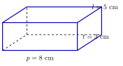

## Hasil Akhir

**Balok $8 \times 5 \times 3$ cm: luas permukaan $= 158$ cm² (kulit luar), volume $= 120$ cm³ (isi).**

## Diketahui & Ditanya

- Sebuah balok mempunyai panjang $p = 8$ cm, lebar $l = 5$ cm, dan tinggi $t = 3$ cm.
- Ditanya: apa perbedaan luas permukaan dan volume balok, dan berapa besar masing-masing?

## Konsep Kunci

**Luas permukaan** adalah jumlah luas seluruh sisi balok — kertas untuk membungkusnya. Ia menyangkut kulit luar, satuannya persegi (cm²). **Volume** adalah banyaknya ruang di dalam balok — air yang dapat ditampungnya. Ia menyangkut isi, satuannya kubik (cm³).

## Langkah Penyelesaian

<figure>
  
  <figcaption>Balok berukuran $8$ cm $\times$ $5$ cm $\times$ $3$ cm; rusuk tersembunyi digambar putus-putus.</figcaption>
</figure>

1. Hitung luas permukaan. Balok mempunyai tiga pasang sisi berhadapan yang sama luas: $p \times l$, $p \times t$, $l \times t$.

$$LP = 2(pl + pt + lt) = 2\big((8 \times 5) + (8 \times 3) + (5 \times 3)\big) = 2(40 + 24 + 15) = 2 \times 79 = 158 \text{ cm}^2$$

2. Hitung volume dengan mengalikan ketiga ukurannya:

$$V = p \times l \times t = 8 \times 5 \times 3 = 120 \text{ cm}^3$$

## Cek Kembali

Periksa satuannya: cm² untuk luas permukaan (penjumlahan luas bidang), cm³ untuk volume (perkalian tiga panjang). Angka $158$ pun wajar: jumlah $6$ sisi berluas $40$, $24$, dan $15$ cm², masing-masing sepasang.

## Kesalahan yang Sering Terjadi

- **Lupa faktor $2$ pada luas permukaan**, hanya menghitung $pl + pt + lt = 79$. Setiap sisi berpasangan dengan sisi yang berhadapan, jadi ketiganya harus digandakan.
- **Menjumlahkan ketiga ukuran sebagai volume** ($8 + 5 + 3 = 16$); volume adalah perkalian, bukan penjumlahan.
- **Tertukar satuan**, menulis luas permukaan dalam cm³ atau volume dalam cm².

## Coba Sendiri

Sebuah kubus mempunyai rusuk $4$ cm. Tentukan luas permukaan dan volumenya.


Kubus adalah balok khusus dengan $p = l = t = 4$ cm, dan keenam sisinya sama.

Luas permukaan — enam sisi berbentuk persegi $4 \times 4$:

$$LP = 6 \times (4 \times 4) = 6 \times 16 = 96 \text{ cm}^2$$

Volume:

$$V = 4 \times 4 \times 4 = 64 \text{ cm}^3$$

Jadi luas permukaannya **$96$ cm²** dan volumenya **$64$ cm³**.

