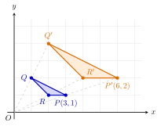

## Hasil Akhir

**Pada dilatasi $[O, 2]$: setiap koordinat dikali $2$, setiap panjang menjadi $2$ kali lipat, dan setiap luas menjadi $2^2 = 4$ kali lipat.**

## Diketahui & Ditanya

- Transformasi: dilatasi dengan pusat $O(0, 0)$ dan faktor skala $k = 2$.
- Ditanya: apa yang terjadi pada koordinat titik, pada panjang sisi, dan pada luas bangun bayangan?

## Konsep Kunci

Dilatasi adalah perbesaran atau pengecilan bangun dari satu titik pusat. Setiap titik $P$ dipindahkan menjauhi pusat sedemikian rupa sehingga jaraknya dari pusat menjadi $k$ kali jarak semula: $OP' = k \cdot OP$, dan $P'$ tetap segaris dengan $O$ dan $P$. Tiga akibatnya berjenjang. Pertama, karena jarak dari titik asal dikali $k$, kedua koordinat titik ikut dikali $k$. Kedua, setiap panjang pada bangun — yang merupakan jarak antara dua titik — ikut dikali $k$. Ketiga, luas adalah hasil kali **dua** panjang (misalnya alas dan tinggi), dan karena kedua panjang itu masing-masing dikali $k$, luas dikali $k \times k = k^2$. Inilah sebabnya luas berubah jauh lebih besar daripada panjangnya.

## Langkah Penyelesaian

1. **Koordinat dikali $k$.** Aturan dilatasi berpusat di $O$ adalah $(x, y) \to (kx, ky)$. Untuk $k = 2$:

$$(3, 1) \longrightarrow (2 \cdot 3, \ 2 \cdot 1) = (6, 2)$$

Perhatikan gambarnya: segitiga $PQR$ (biru) didilatasikan menjadi segitiga $P'Q'R'$ (oranye). Titik-titik lain pada gambar mengikuti aturan yang sama: $Q(1, 2) \to Q'(2, 4)$ dan $R(2, 1) \to R'(4, 2)$.

<figure>
  
  <figcaption>Segitiga $PQR$ dan bayangannya $P'Q'R'$ pada dilatasi $[O, 2]$. Setiap titik bayangan segaris dengan titik asal dan pusat $O$, pada jarak dua kali lipat.</figcaption>
</figure>

2. **Panjang dikali $k$.** Ambil sisi $RP$ pada gambar: dari $R(2, 1)$ ke $P(3, 1)$ panjangnya $1$ satuan. Bayangannya $R'P'$ membentang dari $R'(4, 2)$ ke $P'(6, 2)$, panjangnya $2$ satuan. Setiap panjang pada bangun menjadi $2$ kali lipat, ke arah mana pun sisinya.

3. **Luas dikali $k^2$.** Ambil contoh segitiga lain dengan alas $4$ dan tinggi $3$:

$$L = \tfrac{1}{2} \times 4 \times 3 = 6$$

Sesudah didilatasikan dengan $k = 2$, alasnya menjadi $8$ dan tingginya menjadi $6$:

$$L' = \tfrac{1}{2} \times 8 \times 6 = 24 = 4 \times 6$$

Jadi luasnya menjadi $4$ kali lipat, bukan $2$ kali lipat.

4. **Keliling berperilaku seperti panjang.** Karena keliling adalah jumlah panjang sisi-sisi, ia juga dikali $k$. Persegi bersisi $5$ pada Coba Sendiri, misalnya, kelilingnya berubah dari $20$ menjadi $40$ — dua kali lipat, mengiringi perubahan sisinya, sementara luasnya melesat empat kali lipat. Pola umumnya: besaran satu dimensi (koordinat, panjang, keliling) dikali $k$, besaran dua dimensi (luas) dikali $k^2$, dan kelak pada bangun ruang, besaran tiga dimensi (volume) dikali $k^3$.

5. **Arah perubahan bergantung pada $k$.** Bila $k > 1$ bangun membesar, seperti contoh di atas. Bila $0 < k < 1$ bangun mengecil: untuk $k = \frac{1}{2}$, koordinat dan panjang menjadi setengahnya, sedangkan luas menjadi $\left(\frac{1}{2}\right)^2 = \frac{1}{4}$ kali lipat. Bentuk bangunnya sendiri tidak pernah berubah — dilatasi selalu menghasilkan bangun yang sebangun dengan asalnya, hanya ukurannya yang berbeda.

## Cek Kembali

Periksa perbandingan luasnya: $\frac{L'}{L} = \frac{24}{6} = 4$, dan $k^2 = 2^2 = 4$. Cocok. Periksa juga satu koordinat dari gambar dengan cara jarak: jarak $P(3, 1)$ dari $O$ adalah $\sqrt{3^2 + 1^2} = \sqrt{10}$, sedangkan jarak $P'(6, 2)$ adalah $\sqrt{6^2 + 2^2} = \sqrt{40} = 2\sqrt{10}$, tepat dua kali lipat seperti dituntut definisi dilatasi.

## Kesalahan yang Sering Terjadi

- **Mengira luas juga menjadi $2$ kali lipat.** Kesalahan paling umum. Luas melibatkan dua ukuran panjang yang sama-sama membesar, jadi faktornya $k^2 = 4$, bukan $k = 2$.
- **Menambah $2$ pada koordinat.** Dilatasi itu perkalian, bukan pergeseran: $(3, 1)$ menjadi $(6, 2)$, bukan $(5, 3)$. Menambah adalah ciri translasi.
- **Hanya mengali satu koordinat**, misalnya menulis $(3, 1) \to (6, 1)$. Kedua koordinat wajib dikali faktor skala yang sama agar titik tetap segaris dengan pusat.

## Coba Sendiri

Sebuah persegi mempunyai sisi $5$ cm. Persegi itu didilatasikan dengan faktor skala $2$. Tentukan sisi dan luas persegi bayangannya.


Sisi adalah panjang, jadi dikali $k = 2$:

$$\text{sisi}' = 2 \times 5 = 10 \text{ cm}$$

Luas dikali $k^2 = 4$. Luas semula $5 \times 5 = 25$ cm², sehingga:

$$L' = 4 \times 25 = 100 \text{ cm}^2$$

Cek langsung dari sisi bayangan: $10 \times 10 = 100$ cm². Cocok — sisi menjadi **$10$ cm** dan luas menjadi **$100$ cm²**.

