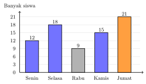

## Hasil Akhir

**Data terbesar: hari Jumat, $21$ siswa. Data terkecil: hari Rabu, $9$ siswa. Selisihnya $12$ siswa.**

## Diketahui & Ditanya

- Diagram batang di bawah menunjukkan banyak siswa yang berkunjung ke perpustakaan sekolah selama lima hari.
- Ditanya: cara membaca diagram seperti ini, hari dengan kunjungan terbesar dan terkecil, serta selisih keduanya.

## Konsep Kunci

Pada diagram batang, **tinggi batang menunjukkan besar nilai datanya**. Cara membacanya: ikuti garis mendatar dari puncak batang ke **sumbu tegak** di sebelah kiri, lalu baca angka yang sejajar dengan puncak itu. Batang tertinggi adalah data terbesar, batang terendah adalah data terkecil, dan selisih keduanya dicari dengan pengurangan.

## Langkah Penyelesaian

<figure>
  
  <figcaption>Banyak siswa yang berkunjung ke perpustakaan per hari.</figcaption>
</figure>

1. Baca nilai setiap batang pada sumbu tegaknya: Senin $12$, Selasa $18$, Rabu $9$, Kamis $15$, Jumat $21$ siswa.

2. Tentukan yang terbesar dan terkecil dari daftar itu: terbesar adalah hari **Jumat** dengan $21$ siswa (batang tertinggi, berwarna oranye), terkecil adalah hari **Rabu** dengan $9$ siswa (batang terendah).

3. Hitung selisihnya:

$$21 - 9 = 12$$

Jadi selisih kunjungan terbesar dan terkecil adalah $12$ siswa.

## Cek Kembali

Urutkan dari kecil ke besar: $9$ (Rabu), $12$ (Senin), $15$ (Kamis), $18$ (Selasa), $21$ (Jumat) — tidak ada yang lebih kecil dari $9$ atau lebih besar dari $21$. Dan $9 + 12 = 21$, cocok dengan selisihnya.

## Kesalahan yang Sering Terjadi

- **Membaca sumbu yang salah skala**: mengira jarak antargaris pada sumbu tegak bernilai $1$, padahal pada diagram ini berjarak $3$. Periksa dulu angka pada sumbu tegak.
- **Menjawab selisih dengan nama hari**, misalnya "Jumat dan Rabu". Selisih yang ditanyakan adalah bilangan: $12$ siswa.

## Coba Sendiri

Sebuah diagram batang menunjukkan banyak buku yang dipinjam: Senin $10$, Selasa $14$, Rabu $14$, Kamis $8$, Jumat $16$. Tentukan hari dengan peminjaman terbesar, terkecil, dan selisihnya.


Nilai terbesar adalah $16$, pada hari **Jumat**. Nilai terkecil adalah $8$, pada hari **Kamis**. Selisihnya:

$$16 - 8 = 8$$

Jadi selisih peminjaman terbesar dan terkecil adalah **$8$ buku**. (Perhatikan: Selasa dan Rabu sama-sama $14$, tetapi keduanya bukan yang terbesar karena Jumat lebih besar.)

