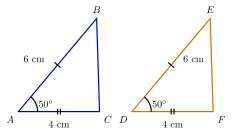

## Hasil Akhir

**Dua segitiga cukup dibuktikan dengan SATU kriteria kekongruenan — tidak perlu keenam sisinya. Pada contoh di bawah, segitiga $ABC$ dan $DEF$ terbukti kongruen menurut kriteria sisi–sudut–sisi (SAS).**

## Diketahui & Ditanya

- Dua segitiga $ABC$ dan $DEF$ dengan $AB = DE = 6$ cm, $\angle A = \angle D = 50^\circ$, dan $AC = DF = 4$ cm.
- Ditanya: bagaimana cara membuktikan kedua segitiga itu kongruen, dan kesimpulan apa yang boleh ditarik sesudahnya?

## Konsep Kunci

Dua bangun disebut **kongruen** bila bentuk dan ukurannya sama persis — bila yang satu diletakkan menutupi yang lain, keduanya berhimpit tepat. Membuktikan kekongruenan segitiga secara langsung berarti memeriksa tiga pasang sisi dan tiga pasang sudut, enam unsur semuanya. Untungnya, para matematikawan menemukan bahwa sebagian unsur menentukan unsur lainnya secara paksa: bila segelintir unsur yang tepat sudah sama, segitiganya tidak bisa tidak sama semua. Segelintir unsur itulah yang disebut **kriteria kekongruenan**. Ada lima kriteria yang sah:

- **Sisi–Sisi–Sisi (SSS):** ketiga pasang sisi bersesuaian sama panjang.
- **Sisi–Sudut–Sisi (SAS):** dua pasang sisi sama panjang dan sudut **di antara** kedua sisi itu (sudut apit) sama besar.
- **Sudut–Sisi–Sudut (ASA):** dua pasang sudut sama besar dan sisi di antara kedua sudut itu sama panjang.
- **Sudut–Sudut–Sisi (AAS):** dua pasang sudut sama besar dan sepasang sisi yang **bukan** di antara kedua sudut itu sama panjang.
- **Khusus segitiga siku-siku:** sisi miring dan satu sisi tegak pada kedua segitiga sama panjang.

## Langkah Penyelesaian

1. **Kumpulkan unsur yang diketahui dari kedua segitiga.** Pada contoh ini diketahui dua pasang sisi, $AB = DE = 6$ cm dan $AC = DF = 4$ cm, serta sepasang sudut, $\angle A = \angle D = 50^\circ$. Perhatikan gambarnya: sisi yang sama panjang ditandai garis kecil yang sama banyaknya, dan sudut yang sama besar ditandai busur yang sama.

<figure>
  
  <figcaption>Segitiga $ABC$ dan $DEF$: tanda yang sama pada gambar berarti unsur yang sama besar — $AB = DE$, $AC = DF$, dan $\angle A = \angle D$.</figcaption>
</figure>

2. **Periksa posisi sudutnya terhadap kedua sisi.** Sudut $A$ dibentuk oleh sisi $AB$ dan $AC$ — tepat kedua sisi yang diketahui. Sudut $D$ pun dibentuk oleh sisi $DE$ dan $DF$. Jadi sudut yang sama besar itu adalah **sudut apit** bagi kedua pasang sisi.

3. **Cocokkan dengan kriteria.** Dua sisi dan sudut apitnya sama — ini pola kriteria **sisi–sudut–sisi (SAS)**. Kriteria terpenuhi, maka:

$$\triangle ABC \cong \triangle DEF$$

4. **Tarik kesimpulan dari kekongruenan.** Karena kedua segitiga kongruen, semua unsur bersesuaian yang belum diketahui otomatis sama: $BC = EF$, $\angle B = \angle E$, $\angle C = \angle F$, dan luas kedua segitiga sama. Urutan huruf pada penulisan $\triangle ABC \cong \triangle DEF$ menunjukkan pasangan titik yang bersesuaian: $A \leftrightarrow D$, $B \leftrightarrow E$, $C \leftrightarrow F$.

## Cek Kembali

Uji keabsahan kriteria yang dipakai: apakah sudut $50^\circ$ benar-benar apit? Sisi-sisi yang mengapit sudut $A$ adalah $AB$ dan $AC$, dan keduanya memang diketahui sama dengan pasangannya. Andaikan yang diketahui sama adalah sudut $B$, bukan sudut $A$, maka kriteria SAS tidak berlaku dan pembuktiannya harus mencari jalan lain. Pemeriksaan posisi sudut inilah yang membedakan pembuktian yang sah dari yang keliru.

## Kesalahan yang Sering Terjadi

- **Memakai pola sisi–sisi–sudut (SSA).** Dua sisi dan satu sudut yang **bukan** apit bukanlah kriteria yang sah: dengan data seperti itu dapat digambar **dua segitiga berbeda** yang sama-sama memenuhi syarat, sehingga kekongruenan tidak terjamin. Inilah jebakan yang paling sering muncul pada soal pembuktian.
- **Salah memasangkan urutan huruf.** Menulis $\triangle ABC \cong \triangle EFD$ padahal yang bersesuaian adalah $A \leftrightarrow D$ membuat semua kesimpulan pasangan sisi dan sudut sesudahnya ikut salah.
- **Menganggap sebangun berarti kongruen.** Segitiga sebangun hanya menuntut bentuk yang sama; ukurannya boleh berbeda. Kekongruenan adalah kesebangunan khusus dengan faktor skala tepat $1$.

## Coba Sendiri

Dua segitiga mempunyai ketiga pasang sisi bersesuaian yang sama panjang. Kriteria apa yang membuktikan keduanya kongruen?


Ketiga pasang sisi sama panjang adalah pola kriteria **sisi–sisi–sisi (SSS)**.

Ketiga sisi menentukan bentuk segitiga secara paksa — tidak ada cara merangkai tiga ruas garis menjadi segitiga dengan bentuk lain — sehingga ketiga sudutnya pun pasti sama besar dan kedua segitiga itu kongruen.

