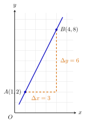

## Hasil Akhir

**Gradien garis yang melalui titik $(1, 2)$ dan $(4, 8)$ adalah $m = 2$.**

## Diketahui & Ditanya

- Garis melalui dua titik: $A(1, 2)$ dan $B(4, 8)$.
- Ditanya: gradien (kemiringan) garis tersebut.

## Konsep Kunci

Gradien adalah ukuran kemiringan garis, didefinisikan sebagai perbandingan **perubahan nilai $y$** terhadap **perubahan nilai $x$** ketika kita bergerak dari satu titik ke titik lain di sepanjang garis:

$$m = \frac{\Delta y}{\Delta x} = \frac{y_2 - y_1}{x_2 - x_1}$$

Artinya, gradien menjawab pertanyaan: "setiap $x$ bertambah $1$, berapa bertambahnya $y$?" Garis yang naik ke kanan bergradien positif, garis yang turun ke kanan bergradien negatif. Karena garisnya lurus, perbandingan ini sama di sepanjang garis — dua titik mana pun yang dipilih akan memberi gradien yang sama.

## Langkah Penyelesaian

Perhatikan gambarnya: garis biru melalui $A$ dan $B$, dan garis putus-putus oranye membentuk segitiga bantu yang memperlihatkan $\Delta x$ dan $\Delta y$.

<figure>
  
  <figcaption>Dari $A$ ke $B$: $x$ bertambah $3$ ($\Delta x = 3$) dan $y$ bertambah $6$ ($\Delta y = 6$).</figcaption>
</figure>

1. Beri nama kedua titiknya: $(x_1, y_1) = (1, 2)$ dan $(x_2, y_2) = (4, 8)$. Urutan penamaan bebas, asal dipakai konsisten pada langkah berikutnya.

2. Hitung perubahan $y$ — kurangkan nilai $y$ kedua titik dengan urutan yang sama:

$$\Delta y = y_2 - y_1 = 8 - 2 = 6$$

3. Hitung perubahan $x$ dengan urutan pengurangan yang **sama persis**:

$$\Delta x = x_2 - x_1 = 4 - 1 = 3$$

4. Bagi keduanya:

$$m = \frac{\Delta y}{\Delta x} = \frac{6}{3} = 2$$

Jadi gradien garisnya adalah $2$: setiap $x$ naik $1$ satuan, $y$ naik $2$ satuan.

## Cek Kembali

Pilih titik lain pada garis yang sama, misalnya titik $(2, 4)$ yang juga dilalui garis pada gambar. Hitung gradiennya dari $A(1,2)$ ke $(2, 4)$: $m = \frac{4 - 2}{2 - 1} = \frac{2}{1} = 2$. Sama. Balik urutannya pun tetap sama: dari $B$ ke $A$, $m = \frac{2 - 8}{1 - 4} = \frac{-6}{-3} = 2$. Gradien positif juga cocok dengan gambar: garisnya naik ke kanan.

## Kesalahan yang Sering Terjadi

- **Urutan pengurangan tidak konsisten.** Menghitung $\frac{8 - 2}{1 - 4} = \frac{6}{-3} = -2$ adalah kesalahan klasik: pembilang memakai urutan $B - A$ sedangkan penyebut $A - B$. Pembilang dan penyebut harus memakai urutan titik yang **sama**.
- **Menukar $\Delta x$ dan $\Delta y$**, menulis $m = \frac{3}{6} = \frac{1}{2}$. Ingat rumus gradien adalah perubahan tegak dibagi perubahan mendatar: $\Delta y$ selalu di atas.
- **Mengurangkan koordinat yang tidak sepasang**, misalnya $8 - 1$ atau $4 - 2$. Yang dikurangkan selalu $y$ dengan $y$ dan $x$ dengan $x$.

## Coba Sendiri

Tentukan gradien garis yang melalui titik $(1, 5)$ dan $(3, 8)$.


Gunakan rumus gradien dengan urutan pengurangan yang konsisten:

$$m = \frac{y_2 - y_1}{x_2 - x_1} = \frac{8 - 5}{3 - 1} = \frac{3}{2}$$

Jadi gradiennya adalah **$\frac{3}{2}$**: setiap $x$ naik $2$ satuan, $y$ naik $3$ satuan.

