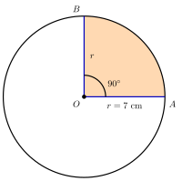

## Hasil Akhir

**Luas juring dengan sudut pusat $90^\circ$ pada lingkaran berjari-jari $7$ cm adalah $38{,}5$ cm².**

## Diketahui & Ditanya

- Lingkaran berjari-jari $r = 7$ cm; dipakai $\pi = \frac{22}{7}$ karena jari-jarinya kelipatan $7$.
- Juring yang dicari dibatasi dua jari-jari dengan sudut pusat $\theta = 90^\circ$.
- Ditanya: luas juring tersebut.

## Konsep Kunci

Juring adalah daerah di dalam lingkaran yang dibatasi oleh dua jari-jari dan busur di antara keduanya — bentuknya seperti sepotong pizza. Besar kecilnya juring ditentukan oleh sudut pusatnya: sudut $90^\circ$ mengambil tepat seperempat lingkaran, sudut $180^\circ$ mengambil setengahnya, dan seterusnya. Karena itu luas juring selalu merupakan **pecahan dari luas lingkaran penuh**, dengan pecahannya adalah perbandingan sudut pusat terhadap satu putaran penuh:

$$L_{\text{juring}} = \frac{\theta}{360^\circ} \times \pi r^2$$

## Langkah Penyelesaian

Perhatikan gambarnya: juring $AOB$ yang terarsir dibatasi jari-jari $OA$ dan $OB$ yang saling tegak lurus.

<figure>
  
  <figcaption>Juring $AOB$ dengan sudut pusat $90^\circ$ dan jari-jari $7$ cm — tepat seperempat bagian lingkaran.</figcaption>
</figure>

1. Hitung dulu luas lingkaran penuhnya:

$$L = \pi r^2 = \frac{22}{7} \times 7^2 = 154 \text{ cm}^2$$

2. Tentukan pecahan juring terhadap lingkaran penuh:

$$\frac{\theta}{360^\circ} = \frac{90^\circ}{360^\circ} = \frac{1}{4}$$

3. Kalikan pecahan itu dengan luas lingkaran:

$$L_{\text{juring}} = \frac{1}{4} \times 154 = 38{,}5 \text{ cm}^2$$

Atau dalam satu baris dengan rumus umumnya: $L_{\text{juring}} = \dfrac{90^\circ}{360^\circ} \times \dfrac{22}{7} \times 7^2 = \dfrac{1}{4} \times 154 = 38{,}5$ cm².

4. Perhatikan bahwa rumus ini bekerja untuk sudut berapa pun dengan cara yang persis sama. Sudut $180^\circ$ memberi pecahan $\frac{1}{2}$, sudut $60^\circ$ memberi $\frac{1}{6}$, dan sudut $360^\circ$ memberi pecahan $1$ — juringnya adalah lingkaran itu sendiri. Tugas kita selalu hanya dua: ubah sudut pusat menjadi pecahan dari satu putaran penuh, lalu kalikan pecahan itu dengan luas lingkaran.

## Cek Kembali

Empat buah juring $90^\circ$ yang disusun akan membentuk lingkaran penuh. Periksa: $4 \times 38{,}5 = 154$ cm², tepat sama dengan luas lingkaran yang dihitung pada langkah 1. Hasilnya juga masuk akal sebagai seperempat dari $154$.

## Kesalahan yang Sering Terjadi

- **Memakai keliling sebagai bilangan yang dibagi pecahan.** Menghitung $\frac{1}{4} \times 44 = 11$ menghasilkan **panjang busur** (dalam cm), bukan luas juring (dalam cm²). Perhatikan satuan yang diminta soal sebelum memilih rumus.
- **Memakai diameter sebagai jari-jari.** Bila soal memberi diameter $14$ cm, jari-jarinya $7$ cm; langsung memakai $14$ membuat luas menjadi empat kali terlalu besar.
- **Tidak menyederhanakan pecahan sudut.** Menulis $\frac{90}{360}$ apa adanya sering membuat perhitungan lebih panjang dan rawan salah; sederhanakan dulu menjadi $\frac{1}{4}$.

## Coba Sendiri

Hitung luas juring dengan sudut pusat $120^\circ$ pada lingkaran berjari-jari $7$ cm.


Pecahan sudutnya adalah $\dfrac{120^\circ}{360^\circ} = \dfrac{1}{3}$, dan luas lingkaran penuhnya tetap $154$ cm²:

$$L_{\text{juring}} = \frac{1}{3} \times 154 = \frac{154}{3} \approx 51{,}33 \text{ cm}^2$$

Jadi luas juringnya adalah **$\frac{154}{3}$ cm² $\approx 51{,}33$ cm²** (dibulatkan dua tempat desimal).

