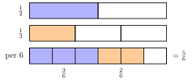

## Hasil Akhir

**$\frac12 + \frac13 = \frac56$** — bukan $\frac25$.

## Diketahui & Ditanya

- Dua pecahan yang dijumlahkan: $\frac12$ dan $\frac13$, dengan penyebut berbeda.
- Ditanya: mengapa menjumlahkan pembilang dan penyebutnya langsung, menjadi $\frac{1+1}{2+3} = \frac25$, tidak dibenarkan?

## Konsep Kunci

Penyebut menunjukkan **ukuran potongan**, sedangkan pembilang menunjukkan **berapa potongan yang diambil**. Potongan setengah dan potongan sepertiga ukurannya tidak sama, jadi tidak bisa langsung digabungkan — seperti menjumlahkan 1 apel dan 1 jeruk lalu menyebutnya "2 apel". Agar bisa dijumlahkan, kedua pecahan harus diubah dulu ke ukuran potongan yang sama, yaitu dengan **menyamakan penyebut**. Perhatikan juga: $\frac25 = 0{,}4$ sebenarnya *lebih kecil* daripada $\frac12$ sendiri. Jumlah dua bilangan positif tidak mungkin lebih kecil dari salah satunya — itu petunjuk awal bahwa $\frac25$ pasti keliru.

## Langkah Penyelesaian

Gambar berikut memperlihatkan intinya. Batang paling bawah dibagi menjadi $6$ potongan sama besar: bagian $\frac12$ mengisi $3$ potong, bagian $\frac13$ mengisi $2$ potong, dan jumlahnya $5$ potong dari $6$.

<figure>
  
  <figcaption>Dengan potongan per-enam, $\frac12$ menjadi $\frac36$ dan $\frac13$ menjadi $\frac26$.</figcaption>
</figure>

1. Cari penyebut bersama, yaitu KPK dari $2$ dan $3$, yaitu $6$.

2. Ubah setiap pecahan menjadi pecahan senilai berpenyebut $6$:

$$\frac12 = \frac{1 \times 3}{2 \times 3} = \frac36 \qquad \text{dan} \qquad \frac13 = \frac{1 \times 2}{3 \times 2} = \frac26$$

3. Sekarang ukuran potongannya sudah sama, jadi pembilang boleh dijumlahkan sedangkan penyebut tetap:

$$\frac36 + \frac26 = \frac{3+2}{6} = \frac56$$

Jadi, $\frac12 + \frac13 = \frac56$.

## Cek Kembali

Kurangkan hasilnya dengan salah satu pecahan awal: $\frac56 - \frac13 = \frac56 - \frac26 = \frac36 = \frac12$, tepat pecahan awal yang lain. Cocok. Perbandingan kasar juga mendukung: $\frac56 \approx 0{,}83$, masuk akal sebagai gabungan $0{,}5 + 0{,}33$.

## Kesalahan yang Sering Terjadi

- **Menjumlahkan pembilang dan penyebut sekaligus** menjadi $\frac25$. Cara ini tidak pernah benar untuk penjumlahan pecahan.
- **Menjumlahkan pembilang tetapi juga menjumlahkan penyebut sesudah disamakan**, misalnya menulis $\frac36 + \frac26 = \frac{5}{12}$. Penyebut yang sudah sama tidak ikut dijumlahkan.
- **Mengalikan penyebut tanpa mengubah pembilang**, misalnya mengubah $\frac12$ menjadi $\frac16$. Setiap pengali pada penyebut harus diterapkan juga pada pembilangnya.

## Coba Sendiri

Berapa hasil dari $\frac14 + \frac16$?


KPK dari $4$ dan $6$ adalah $12$. Ubah kedua pecahan:

$$\frac14 = \frac{3}{12} \qquad \text{dan} \qquad \frac16 = \frac{2}{12}$$

Jumlahkan pembilangnya:

$$\frac{3}{12} + \frac{2}{12} = \frac{5}{12}$$

Jadi hasilnya adalah **$\frac{5}{12}$**.

