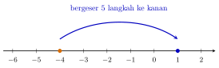

## Hasil Akhir

**$-4-(-5) = 1$**

## Diketahui & Ditanya

- Bilangan pertama: $-4$.
- Operasi yang dilakukan: mengurangkan $-5$, ditulis lengkap sebagai $-4-(-5)$.
- Ditanya: mengapa hasilnya $1$, dan dari mana datangnya jawaban $-9$ yang sering muncul?

## Konsep Kunci

Kuncinya satu kalimat: **mengurangkan suatu bilangan sama artinya dengan menambahkan lawannya**. Lawan dari $-5$ adalah $5$, jadi $a-(-b)$ selalu dapat diubah menjadi $a+b$. Cara lain memandangnya adalah lewat garis bilangan: pengurangan bilangan negatif justru membuat kita bergerak ke **kanan** (arah positif), bukan ke kiri. Jadi $-4-(-5)$ bukan "semakin negatif", melainkan berbalik arah dari yang dibayangkan banyak orang.

## Langkah Penyelesaian

Bayangkan garis bilangan berikut. Kita mulai di titik $-4$, lalu bergerak $5$ langkah ke kanan hingga tiba di titik $1$.

<figure>
  
  <figcaption>Mengurangkan $-5$ berarti bergeser $5$ langkah ke kanan dari $-4$.</figcaption>
</figure>

1. Tulis soalnya dengan lengkap, dengan tanda kurung yang memisahkan tanda operasi dari tanda negatif:

$$-4-(-5)$$

2. Ubah pengurangan bilangan negatif menjadi penjumlahan dengan lawannya. Tanda "kurang" dan "negatif" yang berurutan berubah menjadi "tambah":

$$-4-(-5) = -4 + 5$$

3. Hitung seperti penjumlahan biasa pada garis bilangan: dari $-4$ bergeser $5$ langkah ke kanan melewati $-3$, $-2$, $-1$, $0$, dan berhenti di $1$.

$$-4 + 5 = 1$$

Jadi, $-4-(-5) = 1$.

## Cek Kembali

Pengurangan adalah kebalikan penjumlahan, jadi hasilnya bisa diuji begini: apakah $1 + (-5)$ sama dengan bilangan awal $-4$? Hitung: $1 + (-5) = -4$. Cocok persis, jadi hasil $1$ benar. Sebaliknya, bila jawabannya $-9$, uji yang sama berbunyi $-9 + (-5) = -14$, jauh dari $-4$ — itu tanda $-9$ pasti salah.

## Kesalahan yang Sering Terjadi

- **Menjumlahkan dua-duanya sebagai negatif.** Menulis $-4-5 = -9$ berarti mengabaikan bahwa yang dikurangkan adalah bilangan negatif.
- **Menulis minus ganda tanpa tanda kurung.** Bentuk $-4--5$ membingungkan dan rawan salah baca; selalu pisahkan dengan tanda kurung: $-4-(-5)$.
- **Mengira "kurang" selalu bergerak ke kiri.** Itu hanya berlaku bila yang dikurangkan bilangan positif. Mengurangkan bilangan negatif berbalik arah ke kanan.

## Coba Sendiri

Berapa hasil dari $-6-(-9)$?


Ubah dulu menjadi penjumlahan dengan lawannya:

$$-6-(-9) = -6 + 9 = 3$$

Jadi hasilnya adalah **$3$**. Sebagai pengujian: $3 + (-9) = -6$, sama dengan bilangan awalnya.

