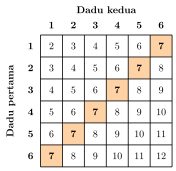

## Hasil Akhir

**Peluang jumlah mata dua dadu sama dengan $7$ adalah $\frac{6}{36} = \frac{1}{6}$.**

## Diketahui & Ditanya

- Dua dadu seimbang dilempar bersamaan satu kali. Kedua dadu dibedakan (dadu pertama dan dadu kedua).
- Ditanya: peluang jumlah kedua mata dadu sama dengan $7$.

## Konsep Kunci

Pada pelemparan dua dadu, setiap dadu mempunyai $6$ kemungkinan mata, sehingga seluruh hasil yang mungkin adalah $6 \times 6 = 36$ **pasangan berurutan** $(a, b)$ — $a$ mata dadu pertama, $b$ mata dadu kedua. Ke-$36$ pasangan ini sama mungkin terjadi. Peluang suatu kejadian adalah banyaknya pasangan yang memenuhi kejadian itu dibagi $36$. Kunci pada soal jenis ini: jangan menghitung dari daftar jumlahnya ($2$ sampai $12$), melainkan dari pasangan-pasangan dadunya, karena jumlah-jumlah itu **tidak** sama mungkin — jumlah $7$ bisa dibentuk dengan banyak cara, sedangkan jumlah $2$ hanya dengan satu cara.

## Langkah Penyelesaian

Perhatikan tabel jumlah kedua mata dadu berikut. Baris menunjukkan mata dadu pertama, kolom menunjukkan mata dadu kedua, dan sel yang disorot adalah sel-sel yang berjumlah $7$.

<figure>
  
  <figcaption>Tabel jumlah mata dua dadu. Sel oranye adalah pasangan-pasangan yang berjumlah $7$ — ada $6$ sel.</figcaption>
</figure>

1. Tentukan banyaknya semua hasil yang mungkin: $6 \times 6 = 36$ pasangan.

2. Daftarkan pasangan yang jumlahnya $7$ — pasangan-pasangannya membentuk diagonal pada tabel:

$$(1, 6), \ (2, 5), \ (3, 4), \ (4, 3), \ (5, 2), \ (6, 1)$$

Ada $6$ pasangan. Perhatikan bahwa $(1, 6)$ dan $(6, 1)$ dihitung sebagai **dua pasangan berbeda**, karena pada $(1,6)$ dadu pertama bermata $1$ sedangkan pada $(6,1)$ dadu pertama bermata $6$.

3. Hitung peluangnya:

$$\text{Peluang} = \frac{6}{36} = \frac{1}{6}$$

Jadi peluang jumlah mata dua dadu sama dengan $7$ adalah $\frac{1}{6}$.

## Cek Kembali

Bandingkan dengan jumlah tetangganya pada tabel: jumlah $6$ dibentuk oleh $5$ pasangan dan jumlah $8$ juga oleh $5$ pasangan, sedangkan jumlah $2$ hanya oleh $1$ pasangan, $(1, 1)$. Jumlah $7$ memang yang paling banyak cara membentuknya — tepat $6$ pasangan — karena ia berada di tengah rentang jumlah. Wajar bila peluangnya paling besar di antara semua jumlah, yaitu $\frac{6}{36}$.

## Kesalahan yang Sering Terjadi

- **Menjawab $\frac{1}{11}$** karena jumlah dua dadu berkisar dari $2$ sampai $12$, ada $11$ nilai. Kesalahannya: ke-$11$ jumlah itu tidak sama mungkin. Jumlah $7$ bisa dibentuk $6$ cara, jumlah $2$ hanya $1$ cara. Peluang harus dihitung dari $36$ pasangannya, bukan dari $11$ jumlahnya.
- **Menghitung $(1, 6)$ dan $(6, 1)$ sebagai satu kejadian.** Kedua dadu adalah benda yang berbeda (misalnya dadu merah dan dadu biru); pasangan terbalik adalah hasil yang berbeda dan sama mungkinnya. Menggabungkannya membuat hitungan jadi $3$ pasangan "tak berurutan" dan peluangnya meleset.
- **Lupa menyederhanakan**, berhenti di $\frac{6}{36}$. Nilai peluang sebaiknya dinyatakan dalam bentuk paling sederhana, $\frac{1}{6}$.

## Coba Sendiri

Berapa peluang jumlah mata dua dadu sama dengan $8$?


Pasangan yang berjumlah $8$ adalah:

$$(2, 6), \ (3, 5), \ (4, 4), \ (5, 3), \ (6, 2)$$

Ada $5$ pasangan dari $36$ pasangan yang mungkin, jadi:

$$\text{Peluang} = \frac{5}{36}$$

Jadi peluang jumlah mata dua dadu sama dengan $8$ adalah **$\frac{5}{36}$**.

