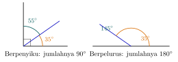

## Hasil Akhir

**Sudut lainnya adalah $55^\circ$.** (Bila kedua sudut itu *berpelurus*, sudut lainnya adalah $145^\circ$.)

## Diketahui & Ditanya

- Dua sudut saling **berpenyiku**, salah satunya $35^\circ$.
- Ditanya: besar sudut yang lain, serta perbedaan berpenyiku dengan berpelurus.

## Konsep Kunci

Dua istilah ini hanya dibedakan oleh jumlahnya. Dua sudut disebut **berpenyiku** bila jumlahnya $90^\circ$ — gabungan keduanya membentuk sudut siku-siku. Dua sudut disebut **berpelurus** bila jumlahnya $180^\circ$ — gabungan keduanya membentuk sudut lurus (satu garis lurus). Jadi, begitu tahu pasangan sudutnya jenis apa, besar sudut yang dicari tinggal dikurangkan dari $90^\circ$ atau dari $180^\circ$.

## Langkah Penyelesaian

Perhatikan kedua gambar berikut: pasangan penyiku di kiri membentuk sudut siku-siku (ada tanda persegi kecil di sudutnya), pasangan pelurus di kanan membentuk garis lurus.

<figure>
  
  <figcaption>Berpenyiku berjumlah $90^\circ$; berpelurus berjumlah $180^\circ$.</figcaption>
</figure>

1. Karena berpenyiku, jumlah kedua sudut adalah $90^\circ$. Kurangkan sudut yang diketahui:

$$90^\circ - 35^\circ = 55^\circ$$

2. Untuk perbandingan, bila sudut $35^\circ$ itu berpelurus dengan sudut lain, jumlahnya $180^\circ$:

$$180^\circ - 35^\circ = 145^\circ$$

Jadi sudut penyiku dari $35^\circ$ adalah $55^\circ$, sedangkan sudut pelurusnya $145^\circ$.

## Cek Kembali

Jumlahkan kembali: $35^\circ + 55^\circ = 90^\circ$, benar untuk pasangan berpenyiku. Dan $35^\circ + 145^\circ = 180^\circ$, benar untuk pasangan berpelurus.

## Kesalahan yang Sering Terjadi

- **Tertukar jumlahnya**, mengurangkan dari $180^\circ$ padahal soalnya berpenyiku, atau sebaliknya. Kuncinya: pe**nyiku** berkaitan dengan sudut **siku-siku** ($90^\circ$), pe**lurus** berkaitan dengan sudut **lurus** ($180^\circ$).
- **Mengira pelurusnya adalah $90^\circ-35^\circ$ juga** — pelurus selalu memakai $180^\circ$.
- **Tidak memperhatikan kata kuncinya di soal.** Bacalah apakah soal menyebut "berpenyiku" atau "berpelurus" sebelum menghitung.

## Coba Sendiri

Sebuah sudut besarnya $28^\circ$. Berapa besar sudut penyikunya?


Sudut penyiku berjumlah $90^\circ$, jadi:

$$90^\circ - 28^\circ = 62^\circ$$

Jadi besar sudut penyikunya adalah **$62^\circ$**. (Sebagai tambahan: sudut pelurus dari $28^\circ$ adalah $180^\circ - 28^\circ = 152^\circ$.)

