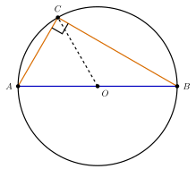

## Hasil Akhir

**Sudut keliling yang menghadap diameter selalu $90^\circ$ karena ia menghadap sudut pusat sebesar $180^\circ$ — sudut keliling besarnya setengah sudut pusat, dan $\frac{1}{2} \times 180^\circ = 90^\circ$.**

## Diketahui & Ditanya

- $AB$ adalah diameter sebuah lingkaran berpusat di $O$, dan $C$ adalah titik mana pun pada lingkaran.
- Ditanya: mengapa $\angle ACB$ selalu tepat $90^\circ$, di mana pun posisi titik $C$ pada lingkaran?

## Konsep Kunci

Dua fakta menjadi kunci. Pertama, **sudut keliling** — sudut yang titik sudutnya terletak pada lingkaran — besarnya selalu **setengah** sudut pusat yang menghadap busur yang sama. Kedua, diameter adalah ruas garis lurus yang melalui pusat, sehingga sudut pusat yang "menghadap" diameter sesungguhnya adalah sudut lurus sebesar $180^\circ$. Menggabungkan keduanya langsung memberi jawaban. Namun hubungan setengah itu sendiri bukan sulap: ia dapat dijejaki dari fakta sederhana bahwa semua jari-jari sama panjang, sehingga terbentuk segitiga-segitiga sama kaki. Langkah-langkah di bawah menunjukkan kedua jalan itu.

## Langkah Penyelesaian

Perhatikan gambarnya: diameter $AB$ digambar mendatar, titik $C$ terletak pada lingkaran, dan jari-jari $OC$ digambar putus-putus.

<figure>
  
  <figcaption>Sudut keliling $\angle ACB$ menghadap diameter $AB$. Tanda siku-siku di $C$ menunjukkan sudutnya $90^\circ$.</figcaption>
</figure>

1. **Tentukan sudut pusat yang menghadap busur yang sama dengan sudut keliling.** Sudut keliling $\angle ACB$ menghadap busur $AB$. Sudut pusat yang menghadap busur $AB$ adalah $\angle AOB$. Karena $A$, $O$, $B$ segaris lurus, $\angle AOB = 180^\circ$.

2. **Pakai hubungan sudut keliling dan sudut pusat.** Besar sudut keliling adalah setengah sudut pusat pada busur yang sama:

$$\angle ACB = \frac{1}{2} \times \angle AOB = \frac{1}{2} \times 180^\circ = 90^\circ$$

3. **Lihat mengapa hubungan itu masuk akal, dengan bantuan $OC$.** Karena $OA$, $OB$, dan $OC$ semuanya jari-jari, ketiganya sama panjang. Akibatnya segitiga $AOC$ sama kaki dan segitiga $BOC$ juga sama kaki. Tulis $\angle OAC = \angle OCA = \alpha$ dan $\angle OBC = \angle OCB = \beta$.

4. **Jumlahkan sudut-sudut segitiga $ABC$.** Ketiga sudutnya adalah $\alpha$ di titik $A$, $\beta$ di titik $B$, dan $\alpha + \beta$ di titik $C$ (gabungan dua sudut dari langkah 3). Jumlah sudut segitiga adalah $180^\circ$:

$$\alpha + \beta + (\alpha + \beta) = 180^\circ \;\Longrightarrow\; 2(\alpha + \beta) = 180^\circ \;\Longrightarrow\; \alpha + \beta = 90^\circ$$

Padahal $\alpha + \beta$ tidak lain adalah $\angle ACB$ itu sendiri. Jadi sudut di $C$ terbukti $90^\circ$ langsung dari sifat segitiga, tanpa bergantung pada posisi $C$.

Sepintas hasil ini terasa ajaib: segitiga yang dibentuk bisa sangat "miring" — misalnya bila $C$ digeser sangat dekat ke titik $A$ sehingga segitiganya panjang dan pipih — dan sudut di $C$ tetap saja tepat $90^\circ$. Langkah 4 menjelaskan mengapa keajaiban itu bukan kebetulan: sepasang sudut sama kaki yang terbentuk selalu menyumbang $\alpha + \beta$, dan jumlah seluruh sudut segitiga yang tetap $180^\circ$ memaksa $\alpha + \beta$ selalu $90^\circ$, betapapun miring segitiganya. Sifat ini dikenal sebagai sudut dalam setengah lingkaran, dan ia sering dipakai terbalik: bila sebuah segitiga yang tertulis dalam lingkaran mempunyai satu sudut $90^\circ$, sisi di hadapan sudut itu pasti diameter.

## Cek Kembali

Uji dengan posisi khusus: letakkan $C$ tepat di puncak lingkaran, tegak lurus di atas $O$. Segitiga $ABC$ menjadi segitiga sama kaki dengan $AC = BC$ dan kedua sudut alasnya masing-masing $45^\circ$, sehingga sudut puncaknya $180^\circ - 45^\circ - 45^\circ = 90^\circ$. Cocok dengan kesimpulan umum — dan langkah 4 menunjukkan hasil yang sama berlaku untuk semua posisi $C$.

## Kesalahan yang Sering Terjadi

- **Mengira aturan ini berlaku untuk semua tali busur.** Sudut keliling hanya dijamin $90^\circ$ bila tali busur yang dihadapnya adalah **diameter**. Menghadap tali busur biasa, besar sudutnya setengah sudut pusat yang bersangkutan — tidak harus $90^\circ$.
- **Membalik hubungan setengahnya**, menulis sudut keliling $= 2 \times$ sudut pusat. Yang benar: sudut **pusat** adalah dua kali sudut keliling, atau sudut keliling setengah sudut pusat.
- **Menganggap hasil bergantung pada posisi titik $C$.** Selama $C$ pada lingkaran dan $AB$ diameter, hasilnya selalu $90^\circ$; memindahkan $C$ hanya mengubah bentuk segitiganya, bukan besar sudutnya.

## Coba Sendiri

Sebuah sudut keliling menghadap busur yang besar sudut pusatnya $100^\circ$. Berapa besar sudut keliling itu?


Sudut keliling besarnya setengah sudut pusat yang menghadap busur yang sama:

$$\frac{1}{2} \times 100^\circ = 50^\circ$$

Jadi besar sudut kelilingnya adalah **$50^\circ$**. Perhatikan: soal ini bukan kasus diameter (sudut pusatnya bukan $180^\circ$), sehingga hasilnya bukan $90^\circ$ — yang selalu berlaku adalah hubungan setengahnya.

