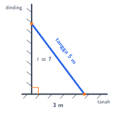

## Hasil Akhir

**Ujung tangga mencapai tinggi 4 m dari tanah.**

## Diketahui & Ditanya

- Panjang tangga $= 5$ m. Tangga menjadi sisi terpanjang (sisi miring) pada gambar.
- Jarak kaki tangga ke dinding $= 3$ m.
- Ditanya: tinggi ujung tangga pada dinding, kita sebut $t$.

## Konsep Kunci

Dinding berdiri tegak lurus terhadap tanah, sehingga dinding, tanah, dan tangga membentuk **segitiga siku-siku** dengan sudut siku-siku di kaki dinding. Pada segitiga siku-siku berlaku teorema Pythagoras: kuadrat sisi miring sama dengan jumlah kuadrat kedua sisi lainnya, $a^2 + b^2 = c^2$. Karena yang dicari adalah salah satu sisi tegak (bukan sisi miring), hubungan itu kita balik: kuadrat sisi tegak sama dengan kuadrat sisi miring dikurangi kuadrat sisi tegak yang lain.

## Langkah Penyelesaian

Perhatikan gambarnya terlebih dahulu — tangga adalah garis miring berwarna biru, dan tanda oranye kecil di kaki dinding menunjukkan sudut siku-siku.

<figure>
  
  <figcaption>Dinding, tanah, dan tangga membentuk segitiga siku-siku.</figcaption>
</figure>

1. Tuliskan hubungan Pythagoras untuk segitiga ini, dengan $t$ sebagai tinggi yang dicari:

$$t^2 + 3^2 = 5^2$$

2. Pindahkan sisi yang sudah diketahui ke ruas kanan. Perhatikan: karena $t$ adalah sisi tegak, bentuknya adalah **pengurangan**, bukan penjumlahan:

$$t^2 = 5^2 - 3^2$$

3. Hitung kuadratnya:

$$t^2 = 25 - 9 = 16$$

4. Ambil akar kuadratnya. Kita ambil nilai positif karena $t$ adalah panjang:

$$t = \sqrt{16} = 4$$

Jadi tinggi ujung tangga adalah $4$ m.

## Cek Kembali

Masukkan hasilnya ke hubungan awal: $3^2 + 4^2 = 9 + 16 = 25 = 5^2$. Cocok. Hasilnya juga masuk akal: tinggi ujung tangga ($4$ m) harus lebih kecil daripada panjang tangganya sendiri ($5$ m), karena tangga bersandar miring.

## Kesalahan yang Sering Terjadi

- **Menjumlahkan, bukan mengurangkan.** Menulis $t = \sqrt{5^2 + 3^2}$ adalah kesalahan paling umum. Penjumlahan hanya dipakai bila yang dicari adalah sisi miring; bila yang dicari sisi tegak, gunakan pengurangan.
- **Salah menempatkan sisi miring.** Sisi miring selalu yang berhadapan dengan sudut siku-siku — di soal ini tangga ($5$ m), bukan dinding.
- **Berhenti di $t^2 = 16$.** Soal menanyakan $t$, jadi masih harus diakar: $t = 4$, dan jangan lupa satuannya (meter).

## Coba Sendiri

Sebuah tangga sepanjang $10$ m bersandar pada dinding. Kaki tangga berjarak $6$ m dari dinding. Setinggi apa ujung tangga itu?


Susunan dinding, tanah, dan tangga sama seperti soal di atas, jadi tinggi $t$ dicari dengan pengurangan:

$$t^2 = 10^2 - 6^2 = 100 - 36 = 64$$

$$t = \sqrt{64} = 8$$

Jadi ujung tangga mencapai tinggi **8 m**. (Pasangan $6$–$8$–$10$ ini adalah kelipatan tripel Pythagoras $3$–$4$–$5$.)

