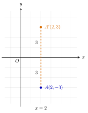

## Hasil Akhir

**Bayangan titik $A(2, -3)$ setelah dicerminkan terhadap sumbu-$x$ adalah $A'(2, 3)$.**

## Diketahui & Ditanya

- Titik asal: $A(2, -3)$, terletak $3$ satuan di bawah sumbu-$x$.
- Garis cermin: sumbu-$x$.
- Ditanya: koordinat titik bayangannya.

## Konsep Kunci

Pencerminan memindahkan setiap titik secara tegak lurus terhadap garis cermin, sejauh jarak yang sama, ke sisi yang berlawanan — persis seperti bayangan pada cermin datar. Karena sumbu-$x$ adalah garis horizontal, titik bergerak lurus ke atas atau ke bawah: absisnya ($x$) tidak berubah, sedangkan ordinatnya ($y$) berganti tanda karena titik berpindah sisi terhadap sumbu-$x$. Aturan umumnya:

$$(x, y) \longrightarrow (x, -y)$$

Satu hal lagi yang perlu digarisbawahi: pencerminan tidak pernah mengubah jarak. Titik asal dan bayangannya selalu berjarak persis sama dari garis cermin, dan ruas garis yang menghubungkan keduanya selalu tegak lurus terhadap garis cermin itu. Titik yang kebetulan terletak tepat pada sumbu-$x$ tidak berpindah sama sekali — ia adalah bayangannya sendiri.

## Langkah Penyelesaian

Perhatikan gambarnya: titik $A$ berada di bawah sumbu-$x$, dan garis putus-putus $x = 2$ menunjukkan lintasan tegak lurus yang dilalui titik menuju bayangannya.

<figure>
  
  <figcaption>Titik $A(2, -3)$ dan bayangannya $A'(2, 3)$ sama-sama berjarak $3$ satuan dari sumbu-$x$, pada garis vertikal yang sama $x = 2$.</figcaption>
</figure>

1. Tentukan jarak titik $A$ ke sumbu-$x$. Nilai $y = -3$ berarti titik berada $3$ satuan di bawah sumbu-$x$.

2. Bayangannya harus berada $3$ satuan di sisi berlawanan, yaitu $3$ satuan di **atas** sumbu-$x$, pada garis vertikal yang sama. Jadi nilai $y$ bayangan adalah $3$.

3. Nilai $x$ tidak berubah karena titik tidak bergeser ke kiri atau ke kanan: tetap $x = 2$.

4. Terapkan aturannya sebagai pemeriksaan singkat: $(x, y) \to (x, -y)$, sehingga $(2, -3) \to (2, 3)$.

Jadi bayangan titik $A(2, -3)$ adalah $A'(2, 3)$.

## Cek Kembali

Dua syarat pencerminan terpenuhi. Pertama, jarak kedua titik ke sumbu-$x$ sama: $A$ berjarak $3$ di bawah, $A'$ berjarak $3$ di atas. Kedua, ruas garis $AA'$ tegak lurus sumbu-$x$ dan titik tengahnya tepat pada sumbu-$x$, yaitu $\left(\frac{2 + 2}{2}, \frac{-3 + 3}{2}\right) = (2, 0)$. Keduanya sesuai dengan sifat bayangan pada cermin datar.

## Kesalahan yang Sering Terjadi

- **Mengganti tanda $x$, bukan tanda $y$.** Menulis bayangannya $(-2, -3)$ adalah hasil pencerminan terhadap sumbu-$y$. Ingat: cermin sumbu-$x$ bersifat horizontal, jadi koordinat yang berubah adalah $y$.
- **Mengganti kedua tanda sekaligus.** Hasil $(-2, 3)$ adalah bayangan terhadap titik asal $O(0, 0)$, bukan terhadap sumbu-$x$.
- **Membiarkan titik tetap di bawah sumbu-$x$.** Bayangan harus selalu muncul di sisi berlawanan dari cermin; bila hasilnya masih bertanda negatif, tandanya belum dibalik.

## Coba Sendiri

Tentukan bayangan titik $(-4, 5)$ setelah dicerminkan terhadap sumbu-$x$.


Terapkan aturan $(x, y) \to (x, -y)$: nilai $x$ tetap $-4$, tanda $y$ berbalik dari $5$ menjadi $-5$.

$$(-4, 5) \longrightarrow (-4, -5)$$

Jadi bayangannya adalah **$(-4, -5)$**, terletak $5$ satuan di bawah sumbu-$x$.

